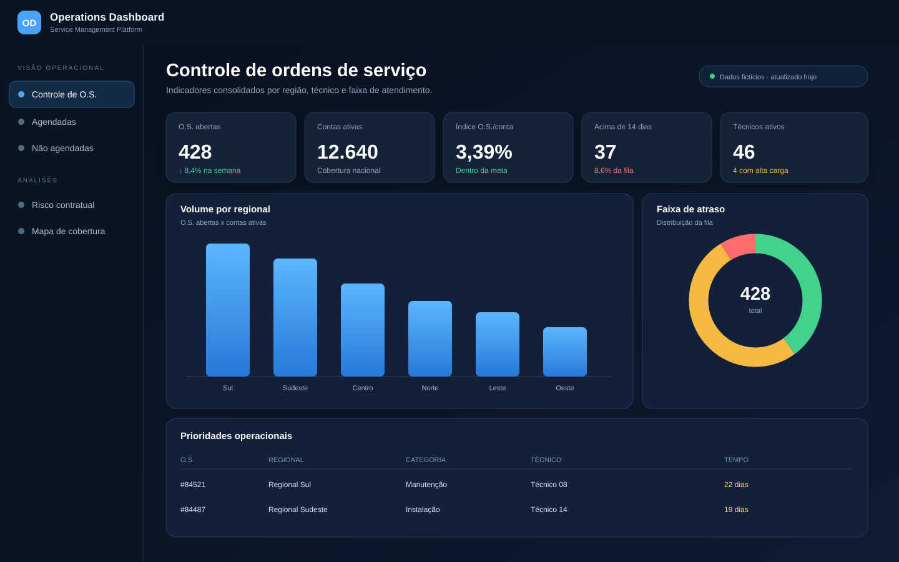

# Operations Dashboard Platform

Plataforma web para acompanhamento de ordens de serviço, agendas, pendências operacionais e indicadores de campo.

O projeto transforma planilhas operacionais dispersas em uma visão única, navegável e orientada à tomada de decisão. A aplicação processa arquivos Excel, normaliza os registros e disponibiliza dashboards interativos com filtros, rankings, faixas de atraso e indicadores de capacidade operacional.

> **Projeto de portfólio:** os dados, nomes e credenciais reais não fazem parte deste repositório. A demonstração utiliza somente informações fictícias.

## Demonstração

[**Abrir demonstração estática**](https://jvfaraco.github.io/operational-dashboard-platform/)

A demo foi criada a partir da identidade visual e dos componentes presentes nos templates do projeto. Ela funciona sem backend e pode ser publicada pelo GitHub Pages.



### O que funciona na demo

- layout responsivo para desktop e dispositivos móveis;
- cards de indicadores operacionais;
- gráfico de volume por regional;
- distribuição por faixa de atraso;
- tabela de prioridades;
- visão de capacidade das equipes;
- botão para acessar o código-fonte;
- impressão ou exportação da visão pelo navegador.

A versão estática é uma vitrine. Login, upload de Excel, processamento com pandas e endpoints internos pertencem à aplicação Flask executada localmente ou em um servidor Python.

## Visão geral

A plataforma reúne cinco módulos principais:

- **Controle de ordens de serviço:** visão consolidada por região, técnico, motivo e faixa de dias.
- **Agendadas:** acompanhamento de atendimentos com data definida.
- **Não agendadas:** identificação de pendências sem programação.
- **Risco contratual:** análise de registros suspensos, exposição e tempo de permanência.
- **Mapa de cobertura:** visualização geográfica de áreas, equipes e distribuição operacional.

## Problema resolvido

Antes da aplicação, a análise dependia de múltiplas planilhas e filtros manuais. Isso dificultava responder perguntas como:

- Qual região concentra mais ordens pendentes?
- Quais técnicos possuem maior volume?
- Quantos atendimentos ultrapassaram o prazo operacional?
- Qual é a relação entre contas ativas e ordens abertas?
- Onde estão os principais pontos de concentração geográfica?

A plataforma centraliza essas respostas em dashboards acessíveis por navegador.

## Principais recursos

- Upload controlado de arquivos `.xlsx`.
- Cache em memória invalidado quando a base é atualizada.
- Indicadores e gráficos com filtros interativos.
- Rankings por técnico, regional e motivo.
- Faixas de tempo para priorização operacional.
- Exportação de dados filtrados.
- Tema claro e escuro.
- Layout responsivo.
- API interna em JSON para separar processamento e visualização.
- Variáveis de ambiente para credenciais e configuração.
- Dados operacionais ignorados pelo Git.
- Demonstração estática publicada pelo GitHub Pages.

## Stack

| Camada | Tecnologia |
|---|---|
| Backend | Python, Flask 3 e Waitress |
| Processamento | pandas, NumPy e openpyxl |
| Frontend | HTML, CSS, JavaScript e Jinja2 |
| Visualização | Chart.js e Leaflet |
| Configuração | python-dotenv |
| Persistência atual | Arquivos Excel e metadados JSON locais |
| Demo pública | HTML e CSS estáticos no GitHub Pages |

## Arquitetura

```text
Planilhas Excel
      │
      ▼
Upload e validação
      │
      ▼
Leitura e normalização com pandas
      │
      ├── Cache em memória
      ├── Metadados de atualização
      └── APIs JSON
              │
              ▼
Dashboards e mapa operacional
```

A demonstração pública segue um fluxo separado:

```text
Dados fictícios embutidos
      │
      ▼
HTML e CSS estáticos
      │
      ▼
GitHub Actions
      │
      ▼
GitHub Pages
```

Uma descrição mais detalhada está em [`docs/ARCHITECTURE.md`](docs/ARCHITECTURE.md).

## Estrutura

```text
operational-dashboard-platform/
├── app.py
├── requirements.txt
├── .env.example
├── .github/
│   └── workflows/
│       └── pages.yml
├── data/
│   └── .gitkeep
├── docs/
│   ├── index.html
│   ├── .nojekyll
│   ├── ARCHITECTURE.md
│   └── assets/
│       └── dashboard-overview.svg
├── static/
│   ├── css/
│   └── js/
├── templates/
├── CONTRIBUTING.md
├── SECURITY.md
└── README.md
```

## Execução local

### 1. Clone o repositório

```bash
git clone https://github.com/JvFaraco/operational-dashboard-platform.git
cd operational-dashboard-platform
```

### 2. Crie o ambiente virtual

```bash
python -m venv .venv
```

No Windows:

```bash
.venv\Scripts\activate
```

No Linux ou macOS:

```bash
source .venv/bin/activate
```

### 3. Instale as dependências

```bash
pip install -r requirements.txt
```

### 4. Configure o ambiente

```bash
cp .env.example .env
```

No Windows PowerShell:

```powershell
Copy-Item .env.example .env
```

Preencha valores locais e nunca envie o `.env` ao GitHub.

### 5. Adicione bases anonimizadas

```text
data/
├── bios.xlsx
├── agendadas.xlsx
├── nao_agendadas.xlsx
└── base.xlsx
```

### 6. Inicie

```bash
python app.py
```

Acesse `http://localhost:5000`.

## Publicação da demo

O workflow [`.github/workflows/pages.yml`](.github/workflows/pages.yml) publica a pasta `docs/` após mudanças na branch `main`.

Depois do merge, abra no GitHub:

```text
Settings → Pages → Source → GitHub Actions
```

A demo será disponibilizada em:

```text
https://jvfaraco.github.io/operational-dashboard-platform/
```

## Endpoints principais

| Endpoint | Método | Finalidade |
|---|---:|---|
| `/` | GET | Página inicial |
| `/upload` | GET/POST | Importação de bases |
| `/controle-os` | GET | Dashboard consolidado |
| `/agendadas` | GET | Ordens agendadas |
| `/nao-agendadas` | GET | Ordens sem agenda |
| `/recred` | GET | Indicadores de risco contratual |
| `/mapa-cobertura` | GET | Mapa operacional |
| `/api/controle-os` | GET | Dados consolidados em JSON |
| `/api/base` | GET | Base compartilhada em JSON |
| `/api/meta/<tipo>` | GET | Metadados da base |

## Decisões técnicas

- **Flask:** suficiente para uma aplicação interna leve, com baixa complexidade de implantação.
- **pandas:** adequado para transformar bases Excel já utilizadas pela operação.
- **JavaScript sem framework:** reduz dependências e mantém a interface simples de hospedar.
- **Cache por data de modificação:** evita reler planilhas em todas as requisições.
- **Waitress:** fornece servidor WSGI apropriado para execução fora do modo de desenvolvimento.
- **Demo estática separada:** permite mostrar o produto sem expor backend, credenciais ou bases reais.

## Limitações conhecidas

A aplicação principal ainda utiliza arquivos locais como fonte de dados. Para maior volume, concorrência e auditoria, a evolução natural é migrar usuários, histórico e registros processados para banco de dados, mantendo o Excel apenas como entrada ou integração temporária.

Evoluções planejadas:

- autenticação com usuários e perfis em banco;
- testes automatizados de rotas e transformações;
- pipeline de qualidade para o backend;
- banco SQLite ou PostgreSQL;
- importação assíncrona de arquivos grandes;
- métricas de produtividade e histórico temporal;
- implantação com container.

## Segurança e privacidade

Este repositório não deve conter:

- planilhas reais;
- nomes de clientes ou colaboradores;
- endereços e coordenadas reais;
- tokens, senhas ou chaves;
- URLs internas;
- exports de sistemas corporativos.

Consulte [`SECURITY.md`](SECURITY.md) antes de publicar alterações.

## Autor

Desenvolvido por **João Victor Faraco** como projeto de automação, dados e gestão operacional.
