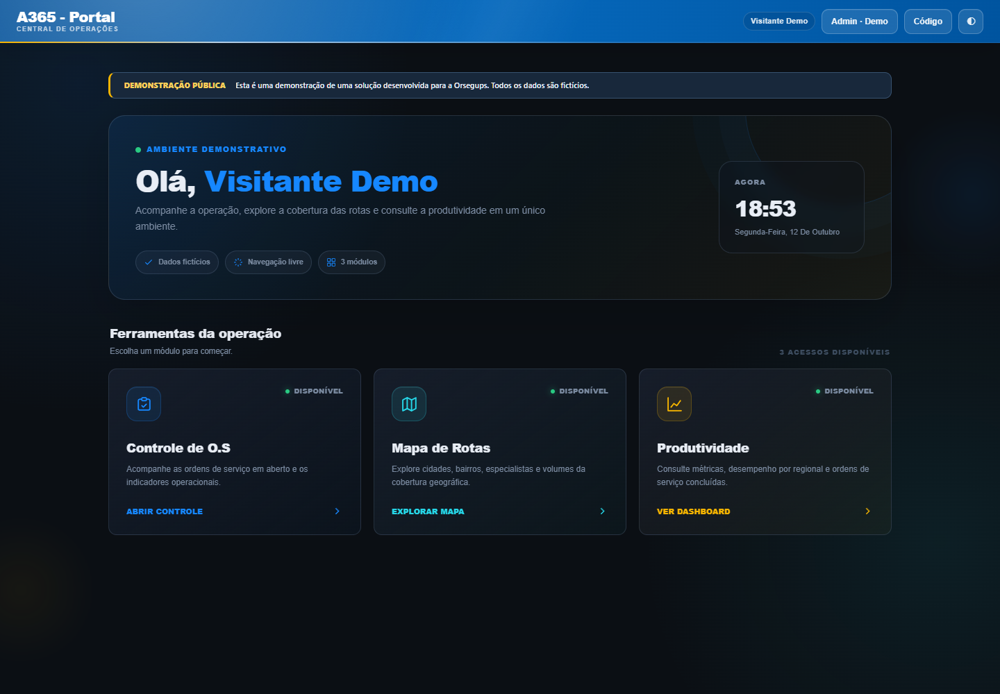

# Portal A365 — Demonstração pública

**Este repositório público é apenas uma demonstração de uma solução desenvolvida para a empresa Orsegups.** Ele apresenta o Portal A365 com dados genéricos, sem acesso aos sistemas, credenciais, contas ou informações operacionais da empresa.

[**Abrir demonstração ↗**](https://jvfaraco.github.io/operational-dashboard-platform/) · [Portfólio do autor](https://jvfaraco.github.io/jvfaraco-portifolio/)



## A mesma interface, com dados fictícios

As telas foram copiadas do código atual do Portal A365. O **CSS, as cores, as animações, os gráficos, os filtros e os cálculos de frontend** foram preservados. As fontes de dados foram substituídas por bases demonstrativas locais, e os cadastros de pessoas/regiões por exemplos fictícios.

| Tela | O que explorar |
|---|---|
| **Menu do portal** | Acesso aos três módulos, tema claro/escuro, relógio e efeitos dos cards. |
| **Controle de O.S.** | Supervisores, faixas de atraso, tipos, vínculo, escopo, regionais/cidades, ranking, agendadas, CSV e download do dashboard. |
| **Produtividade** | Calendário, períodos, granularidade diária/semanal/mensal, dias da semana, filtros, comparações, projeções, desinstalações, RECRED e tabela executiva. |
| **Mapa de Rotas** | Áreas, especialistas, supervisores, camadas, vínculo, volume, busca, seleção de rota e download do mapa. As geometrias e localizações são fictícias. |
| **Administração** | Visual original com usuários, alimentação manual, especialistas e regionais demonstrativos. Ações de servidor são simuladas; uploads estão desabilitados. |

As bases contêm **84 OS abertas**, **432 atendimentos concluídos**, **3 regionais**, **9 técnicos** e **3.000 contas fictícias**. Os números são exemplos gerados para navegar pela interface, não resultados da empresa. No painel de produtividade, a exclusão inicial de sábado/domingo e os demais filtros seguem as regras originais; por isso o total visível depende do recorte.

O modo de atualização dos dashboards lê apenas os JSONs demonstrativos deste site. Não há coletor, autenticação corporativa ou chamadas ao UbiDesk/CRM. O mapa usa Leaflet e imagens públicas de basemap; mesmo sem essas imagens, os vetores e filtros fictícios continuam disponíveis.

## Executar a demo

Não é necessário configurar `.env`, banco de dados ou servidor Python.

```sh
npm ci
npm run dev
```

Abra `http://127.0.0.1:4175/operational-dashboard-platform/`. Em hospedagem estática, publique somente `docs/`.

## Verificar

```sh
npx playwright install chromium
npm test
```

No Windows, pode usar o Edge instalado:

```powershell
$env:PW_CHANNEL = 'msedge'
npm test
```

A suíte confere igualdade do CSS com o fonte registrado, navegação, regras de filtros/calendário, exportação da seleção, mapa, administração simulada, telas de 320/390 px e ausência de chamadas a APIs externas. Capturas podem ser geradas com `node tests/capture.cjs`, com o servidor local ativo. Esses checks não certificam acessibilidade completa: as cores e componentes do portal foram preservados conforme solicitado.

## Estrutura

```text
docs/index.html                  menu original adaptado à demonstração
docs/os.html                     frontend original de Controle de O.S.
docs/produtividade.html           frontend original de Produtividade
docs/rotas.html                   frontend original do mapa
docs/admin.html                   apresentação original; ações simuladas
docs/*_os.json, regionais.json    bases fictícias locais
docs/route_account_volumes.json  volumes fictícios
docs/assets/public-boundary.*    aviso público e restrição das fontes de dados
docs/source-manifest.json        hashes do CSS original
tools/                           exportação e substituição por dados genéricos
tests/                           servidor de desenvolvimento e verificação
```

`app.py`, `templates/` e `static/` preservam uma versão histórica em Flask deste projeto. **Eles não executam a demo atual e não representam o backend privado do Portal A365**, que evoluiu para outra arquitetura. A publicação do GitHub Pages envia somente `docs/`.

As decisões e adaptações estão em [ARCHITECTURE.md](docs/ARCHITECTURE.md). A fonte interna não é publicada; os scripts de exportação exigem acesso autorizado a ela. Nenhuma base real deve ser utilizada para gerar arquivos públicos.

## Autor

**João Victor Faraco** · [GitHub](https://github.com/JvFaraco) · [LinkedIn](https://www.linkedin.com/in/jo%C3%A3o-victor-faraco-01066423a/)
